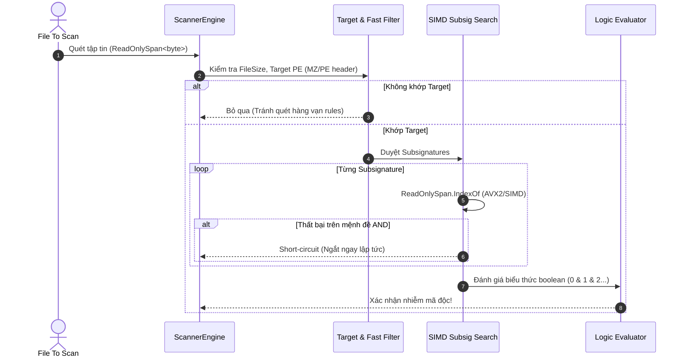

# TÀI LIỆU CHI TIẾT VỀ CƠ SỞ DỮ LIỆU CHỮ KÝ CLAMAV VÀ KIẾN TRÚC CLAMGUARD

Tài liệu này tổng hợp toàn bộ đặc tả kỹ thuật từ tài liệu chuẩn của ClamAV ([ClamAV Signatures Manual](https://docs.clamav.net/manual/Signatures.html), [BodySignatureFormat](https://docs.clamav.net/manual/Signatures/BodySignatureFormat.html), [LogicalSignatures](https://docs.clamav.net/manual/Signatures/LogicalSignatures.html)), kết hợp phân tích đối soát thực tế trên gói cơ sở dữ liệu `C:\ProgramData\ClamGuard\cache\daily_28146_f035c4fd10fd33f9fadd5905acb78b7e` và kiến trúc engine của dự án ClamGuard (.NET 8).

---

## 1. PHÂN NHÓM TOÀN BỘ CƠ SỞ DỮ LIỆU CLAMAV (DATABASE GROUPS)

ClamAV phân loại cơ sở dữ liệu thành **6 nhóm chức năng chính**. Quy ước chung:

- Các file có hậu tố kết thúc bằng chữ **`u`** (ví dụ `.ldu`, `.ndu`, `.hdu`, `.mdu`, `.hsu`, `.msu`) là cơ sở dữ liệu nhận diện **PUA (Potentially Unwanted Application)** - chỉ được nạp khi bật cờ tùy chọn PUA trong cấu hình.
- Mỗi định dạng cơ sở dữ liệu lưu dưới dạng văn bản (text-based), mỗi dòng biểu diễn một chữ ký độc lập, kết thúc bằng ký tự xuống dòng tiêu chuẩn (LF / CRLF).

```mermaid
graph TD
    DB[ClamAV Database Collection]
    DB --> G1[1. Content / Body-Based Sigs]
    DB --> G2[2. Hash-Based Sigs]
    DB --> G3[3. Container & Metadata Sigs]
    DB --> G4[4. Filter, Whitelist & Ignore Sigs]
    DB --> G5[5. Engine Configuration & FTM]
    DB --> G6[6. Phishing & URL Rules]

    G1 --> LDB[Logical Sigs: .ldb, .ldu]
    G1 --> NDB[Extended Sigs: .ndb, .ndu]
    G1 --> CBC[Bytecode Sigs: .cbc]

    G2 --> HDB[File Hash MD5: .hdb, .hdu]
    G2 --> HSB[File Hash SHA256: .hsb, .hsu]
    G2 --> MDB[PE Section MD5: .mdb, .mdu]
    G2 --> MSB[PE Section SHA256: .msb, .msu]

    G3 --> CDB[Container Metadata: .cdb]
    G3 --> IDB[Icon Fuzzy Matching: .idb]
    G3 --> CRB[Authenticode Certificates: .crb, .cat]

    G4 --> FP[File Whitelist: .fp, .sfp]
    G4 --> IGN[Ignored Sigs: .ign, .ign2]

    G5 --> FTM[File Type Magic: .ftm]
    G5 --> CFG[Dynamic Config: .cfg]
    G5 --> INFO[Database Info: .info]

    G6 --> PDB[Phishing Domains: .pdb, .gdb]
    G6 --> WDB[Domain Whitelist: .wdb]
```



---

### NHÓM 1: CHỮ KÝ DỰA TRÊN NỘI DUNG (BODY / CONTENT-BASED SIGNATURES)

Đây là nhóm chữ ký quan trọng và chiếm dung lượng lớn nhất của cơ sở dữ liệu virus (~80MB trong bản daily).

#### 1.1. Logical Signatures (`.ldb`, `.ldu`)

- **Tập tin thực tế:** `daily.ldb` (76,829,701 bytes), `daily.ldu` (3,528,282 bytes).
- **Mục đích:** Kết hợp nhiều mẫu nhị phân, regex, biểu thức logic, điều kiện Target file, PE EntryPoint, FileSize, v.v.
- **Cấu trúc dòng:**
  ```text
  SignatureName;TargetDescriptionBlock;LogicalExpression;Subsig0;Subsig1;...;SubsigN
  ```
- **Ví dụ thực tế:**
  ```text
  Win.Malware.Generic-9828792-0;Engine:81-255,Target:1;0&1&2&3&4;3a3030302c2056657273696f6e3d302e302e302e302c2043756c747572653d6e65757472616c2c205075626c69634b6579546f6b656e3d6e756c6c;726e69772e657865::w;77696e646c2e626174::w;43726565702e50726f706572746965732e5265736f75726365732e7265736f7572636573;43726565702e50726f706572746965732e5265736f7572636573::w
  ```

  - `SignatureName`: `Win.Malware.Generic-9828792-0`
  - `TargetDescriptionBlock`: `Engine:81-255,Target:1` (chỉ quét file PE, Engine phiên bản 81-255)
  - `LogicalExpression`: `0&1&2&3&4` (cả 5 chuỗi con đều phải khớp)
  - `Subsig0..4`: Chuỗi nhị phân cần tìm, trong đó có cờ `::w` (Wide string/UTF-16LE).

#### 1.2. Extended Signatures (`.ndb`, `.ndu`)

- **Tập tin thực tế:** `daily.ndb` (198,238 bytes), `daily.ndu` (823,292 bytes).
- **Mục đích:** Tìm kiếm một chuỗi hex mở rộng liên tục hoặc ngắt quãng bởi wildcard tại offset xác định.
- **Cấu trúc dòng:**
  ```text
  MalwareName:TargetType:Offset:HexPattern[:MinFLevel[:MaxFLevel]]
  ```
- **Ví dụ thực tế:**
  ```text
  Win.Packed.Trickbot-6333881-0:1:EP+0,100:608d3500010000c1ee02eb{-15}56be1000000069f600010000eb{-50}b93d0a000081e93d0200005131f6eb
  ```

  - `TargetType = 1`: File PE Windows.
  - `Offset = EP+0,100`: Neo từ Entry Point, tìm trong phạm vi 0 đến 100 byte.
  - `HexPattern`: Chứa wildcard khoảng cách `{-15}` (tối đa 15 byte bất kỳ).

#### 1.3. Bytecode Signatures (`.cbc`)

- **Mục đích:** Các chương trình bytecode chạy trên môi trường sandbox nội bộ ClamAV nhằm giải mã các thuật toán đóng gói/nén phức tạp (unpackers động).

---

### NHÓM 2: CHỮ KÝ DỰA TRÊN HASH (HASH-BASED SIGNATURES)

Nhóm chữ ký quét cực nhanh dựa trên bảng băm (Hash lookup trong O(1)).

#### 2.1. File Hash Signatures (`.hdb`, `.hdu`, `.hsb`, `.hsu`)

- **Tập tin thực tế:**
  - `daily.hdb` (MD5): `44d88612fea8a8f36de82e1278abb02f:68:Eicar-Test-Signature`
  - `daily.hsb` (SHA256): `275a021bbfb6489e54d471899f7db9d1663fc695ec2fe2a2c4538aabf651fd0f:68:Eicar-Test-Signature`
- **Cấu trúc dòng:**
  ```text
  HashValue:FileSize:MalwareName[:TargetType]
  ```
- **Quy tắc:**
  - So khớp `FileSize` trước (tránh tính hash lãng phí).
  - So khớp mã hash MD5 (32 hex) hoặc SHA256 (64 hex).

#### 2.2. PE Section Hash Signatures (`.mdb`, `.mdu`, `.msb`, `.msu`)

- **Tập tin thực tế:**
  - `daily.mdb` (MD5 của section): `45056:3ea7d00dedd30bcdf46191358c36ffa4:Eicar-Test-Signature`
  - `daily.msb` (SHA256 của section): `45056:f9b304ced34fcce3ab75c6dc58ad59e4d62177ffed35494f79f09bc4e8986c16:Eicar-Test-Signature`
- **Cấu trúc dòng:**
  ```text
  SectionRawSize:HashValue:MalwareName[:TargetType]
  ```
- **Quy tắc:**
  - Khi bóc tách PE Headers, duyệt qua từng PE Section (`.text`, `.data`, `.rsrc`...), lấy kích thước thô (`SizeOfRawData`) và hash của Section đó để so sánh.

---

### NHÓM 3: CHỮ KÝ CONTAINER & METADATA (CONTAINER & METADATA SIGNATURES)

#### 3.1. Container Metadata Signatures (`.cdb`)

- **Tập tin thực tế:** `daily.cdb` (491 bytes).
- **Mục đích:** Phát hiện virus ngụy trang tên file hoặc thuộc tính nén trong file nén (ZIP, RAR, 7Z, TAR, v.v.) mà không cần giải nén toàn bộ dữ liệu.
- **Cấu trúc dòng:**
  ```text
  VirusName:ContainerType:FileSize:FileNameRegex:UncompressedSize:Crypted:FilePosition:Res1:Res2[:MinFLevel[:MaxFLevel]]
  ```
- **Ví dụ thực tế:**
  ```text
  Win.Trojan.Agent-1435085:CL_TYPE_ZIP:*:Order.Pdf_______________________________________________________________\.exe$:*:*:*:*:*:
  ```

  -> Bắt các file ZIP chứa file đuôi kép lừa đảo dài ngoằng (ngụy trang `.pdf....exe`).

#### 3.2. Icon Fuzzy Matching Signatures (`.idb`)

- **Tập tin thực tế:** `daily.idb` (36,469 bytes).
- **Mục đích:** Phát hiện mã độc giả mạo biểu tượng phần mềm nổi tiếng (như icon thư mục Windows, icon PDF Acrobat, Microsoft Word, IE).
- **Cấu trúc dòng:**
  ```text
  IconName:Group1:Group2:IconMetricHex
  ```
- **Thuật toán:** Phân tích ma trận màu, Lab Color Distance, Sobel Edge Filter và Lanczos Resample của icon trích xuất từ tài nguyên PE (`.rsrc`).

#### 3.3. PE Authenticode Certificate Rules (`.crb`, `.cat`)

- **Tập tin thực tế:** `daily.crb` (21,363 bytes).
- **Mục đích:** Danh sách mã băm SHA1/SHA256 của các chứng chỉ số (Digital Certificates) đáng tin cậy hoặc các chứng chỉ giả mạo bị thu hồi.

---

### NHÓM 4: BỘ LỌC, DANH SÁCH TRẮNG & BỎ QUA (FILTERS & WHITELISTS)

#### 4.1. False Positive Whitelist (`.fp`, `.sfp`)

- **Tập tin thực tế:** `daily.fp` (MD5 whitelist), `daily.sfp` (SHA256 whitelist).
- **Cấu trúc dòng:**
  ```text
  HashValue:FileSize:IgnoredSignatureName
  ```
- **Mục đích:** Khi một file quét ra mã độc trùng tên với `IgnoredSignatureName` nhưng có mã băm nằm trong file `.fp`/`.sfp`, engine lập tức bỏ qua và đánh dấu là an toàn (Clean).

#### 4.2. Ignored Signatures (`.ign`, `.ign2`)

- **Tập tin thực tế:** `daily.ign` (29 bytes), `daily.ign2` (554 bytes).
- **Cấu trúc:** Mỗi dòng là một tên chữ ký cần vô hiệu hóa.
- **Ví dụ:**
  ```text
  Xls.Trojan.Laroux-48
  Win.Trojan.B-194
  ```

  -> Khi nạp cơ sở dữ liệu, nếu signature parser đọc thấy tên có trong bảng này thì bỏ qua không nạp vào RAM.

---

### NHÓM 5: CẤU HÌNH ĐỘNG & FILE TYPE MAGIC

#### 5.1. File Type Magic (`.ftm`)

- **Tập tin thực tế:** `daily.ftm` (20,097 bytes).
- **Mục đích:** Nhận diện loại file thực tế thông qua magic bytes đầu file thay vì tin cậy vào phần mở rộng file (extension).
- **Cấu trúc dòng:**
  ```text
  Offset:Shift:HexMagic:TypeName:ParentType:TargetType
  ```
- **Ví dụ:**
  ```text
  0:0:1f8b:GZip:CL_TYPE_ANY:CL_TYPE_GZ
  0:0:28546869732066696c65206d757374206265...:BinHex:CL_TYPE_ANY:CL_TYPE_BINHEX
  ```

#### 5.2. Dynamic Configuration (`.cfg`)

- **Tập tin thực tế:** `daily.cfg` (424 bytes).
- **Mục đích:** Quy định các cờ giải mã, giới hạn recursion, max size cho từng loại bộ giải mã (PE, DOCUMENT, ARCHIVE, BYTECODE).
- **Ví dụ:**
  ```text
  DOCUMENT:0x5:11:13
  PE:0xb4ff:13:23
  ```

#### 5.3. Database Header & Metadata (`.info`, `.complete`)

- **Tập tin thực tế:** `daily.info` (2,285 bytes), `.complete` (38 bytes).
- **Nội dung:** Thông tin phiên bản (Version: 28146), ngày ký phát hành, số lượng signature, và checksum SHA256 của từng file thành phần trong archive CVD.

---

### NHÓM 6: NHẬN DIỆN LỪA ĐẢO & URL (PHISHING RULES)

- **`.pdb` / `.gdb`**: Danh sách domain lừa đảo (Phishing domains). Định dạng `H:domain_name`.
- **`.wdb`**: Danh sách liên kết domain hợp lệ (Phishing whitelist). Định dạng `M:real_domain:displayed_domain` hoặc regex `X:expr`.

---

## 2. BẢNG TRA CỨU MÃ TARGET TRONG CLAMAV (TARGET TYPES)

Trong trường `TargetDescriptionBlock` của `.ldb` hoặc trường `TargetType` của `.ndb`, giá trị `Target:X` quy định file nào được quét:

|  Target ID  | Loại tệp tin mục tiêu (Target Type) | Đặc điểm nhận diện & Chuẩn bị dữ liệu                                   |
| :----------: | :-------------------------------------- | :-------------------------------------------------------------------------------- |
| **0** | **Any File**                      | Quét trên toàn bộ mảng byte thô của bất kỳ file nào.                    |
| **1** | **Portable Executable (PE)**      | Windows EXE, DLL, SYS, OCX (Header`MZ`, PE Signature `PE\0\0`).               |
| **2** | **OLE2 Container**                | Microsoft Office cũ (.doc, .xls, .ppt), MSI installer.                           |
| **3** | **HTML Normalized**               | File HTML đã qua chuẩn hóa (bỏ comment, chữ thường, gộp khoảng trắng). |
| **4** | **Mail File**                     | Định dạng email (.eml, .msg, mbox RFC822).                                     |
| **5** | **Graphics / Images**             | File ảnh định dạng GIF, PNG, JPEG, BMP.                                       |
| **6** | **ELF Executable**                | File thực thi hệ điều hành Linux/Unix (`\x7fELF`).                         |
| **7** | **ASCII Text Normalized**         | File văn bản đã chuẩn hóa chữ thường, lược bỏ khoảng trắng.         |
| **8** | **JavaScript Normalized**         | Mã nguồn JS đã chuẩn hóa cú pháp.                                         |
| **9** | **Mach-O**                        | File thực thi macOS / iOS.                                                       |
| **10** | **PDF Document**                  | File tài liệu PDF (`%PDF-`).                                                  |
| **11** | **Flash (SWF)**                   | Macromedia/Adobe Flash Player file.                                               |
| **12** | **Java Class / JAR**              | Bytecode Java class (`0xCAFEBABE`) hoặc file JAR.                              |

---

## 3. CÁCH THỨC VẬN HÀNH & TỐI ƯU CỦA CLAMGUARD.SCANNER

Dự án **ClamGuard** (.NET 8) mô phỏng chính xác thuật toán ClamAV C/C++ đồng thời tận dụng SIMD phần cứng trên nền tảng .NET:

### 3.1. Pipeline Nhận diện 4 bước (Filter -> SIMD Match -> Short Circuit -> Logic Eval)



### 3.2. Chi tiết kỹ thuật cốt lõi trong Codebase

1. **Bộ lọc sơ cấp theo Target (`TargetFilter`)**:

   - Nếu signature có `Target:1`, engine kiểm tra ngay 2 byte đầu có phải `4D 5A` (`MZ`) hay không. Nếu không phải PE, toàn bộ các chữ ký `Target:1` bị loại bỏ trong **0.0001 ms**.
   - Kiểm tra `FileSize:min-max`, `NumberOfSections`, `EntryPoint` trước khi đọc nội dung.
2. **Tăng tốc tìm kiếm bằng Vector SIMD / AVX2**:

   - Với các chuỗi con cố định (Fixed Bytes) hoặc `::w` (Wide string chèn `0x00`), engine sử dụng `ReadOnlySpan<byte>.IndexOf(...)`.
   - .NET 8 JIT sẽ tự động dịch lệnh này sang instruction CPU tương ứng (`VMOVDQU`, `VPCMPEQB`, `VPBROADCASTB` của tập lệnh AVX2), quét khối 32 byte mỗi chu kỳ CPU thay vì vòng lặp `for (pos++)` từng byte đơn lẻ.
3. **Ngắt sớm Short-Circuit**:

   - Với các signature có cấu trúc `0 & 1 & 2 & 3 & 4`: Khi quét `Subsig0` không tìm thấy trong file, engine **ngắt ngay lập tức**, không tốn CPU quét các `Subsig1..4` còn lại.
4. **Tách biệt module Clean Architecture**:

   - Thư mục `ClamGuard.Signatures/Parsing/`: Chia theo nhóm nội dung (`Content/Ldb`, `Content/Ndb`), hash, container, metadata và common; model/chữ ký chính nằm trong tệp riêng.
   - Thư mục `ClamGuard.Scanner/Image/` và `ClamGuard.Scanner/Executable/`: tách xử lý icon/tài nguyên và metadata thực thi ra khỏi runtime LDB; `ScannerEngine` được chia theo luồng scan, nội dung/logic, chuẩn hóa và nhận diện loại file.


## 4. Quy ước tổ chức source sau tinh gọn

- `ClamGuard.Database/Update/` chứa cập nhật CVD/CDIFF vì đây là một phần của vòng đời cơ sở dữ liệu, không phải project độc lập.
- `ClamGuard.Scanner/Hosting/` chứa scan host, giới hạn hàng đợi, timeout, health và metrics; lớp này dùng trực tiếp engine nên không cần project `ClamGuard.Production`.
- `ClamGuard.Scanner/Containers/` chia xử lý container theo file partial `ArchiveScanner.cs`, `ArchiveScanner.Formats.cs` và `ArchiveScanner.Helpers.cs`; ngân sách archive là model riêng.
- `ClamGuard.Signatures/` dùng các nhóm `Models/`, `Patterns/`, `Matching/`, `Parsing/Content`, `Parsing/Hash`, `Parsing/Container`, `Parsing/Metadata`, `Parsing/Common`. Các đuôi file thuộc cùng họ dùng parser chung thay vì tạo một project hay lớp cấp cao cho mỗi extension.
- CLI độc lập đã được bỏ khỏi solution; ứng dụng WPF và test harness vẫn là entrypoint có sẵn.
